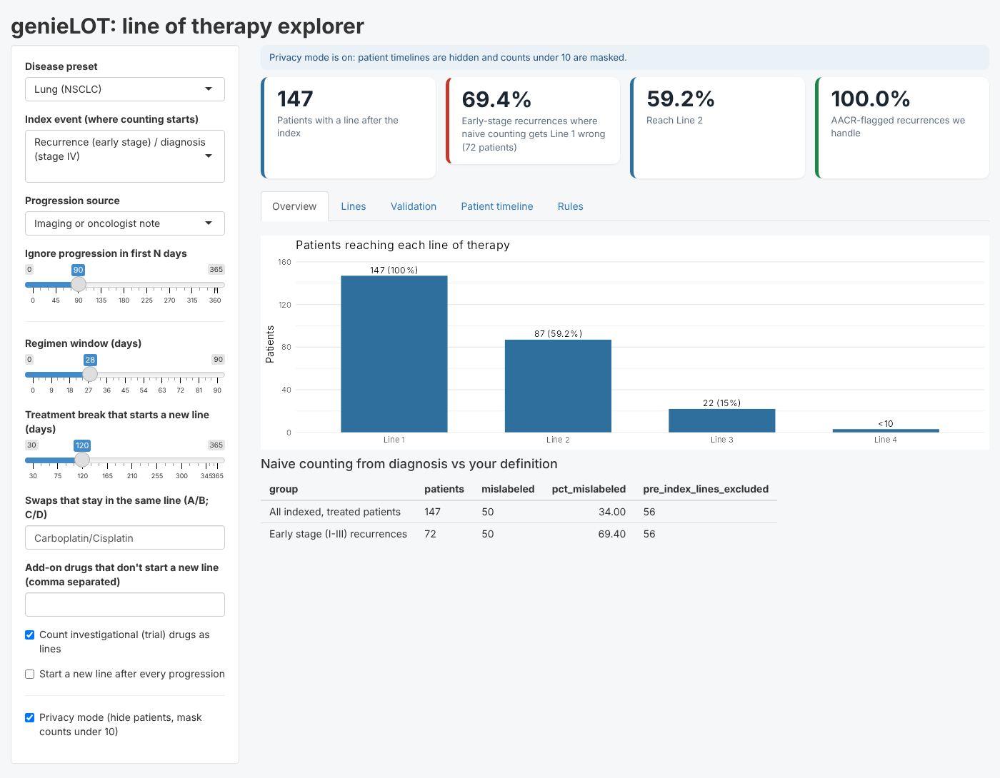
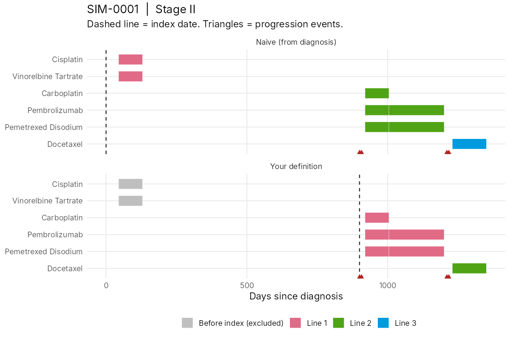

# genieLOT

Line of therapy (LOT) calculation for AACR Project GENIE BPC data, with a
user-chosen index event and user-defined line rules.

**The problem:** early-stage (I–III) patients often get adjuvant or
neoadjuvant treatment, then recur years later. Counting lines from diagnosis
wrongly calls that early treatment "Line 1". genieLOT starts counting at the
index event you choose, so those patients get the right lines.

**Algorithm specification:** [ALGORITHM.md](ALGORITHM.md) (every rule, versioned).

**Results on real GENIE BPC data:** see [RESULTS.md](RESULTS.md) (naive counting gets Line 1 wrong for 63.7% of early-stage NSCLC recurrences).

## Demo



**[Watch the 71-second demo video](demo/genieLOT_demo.mp4)** (simulated patients only).



## Install

```r
# install.packages("remotes")
remotes::install_github("pchar046/genieLOT")
```

## Quick start (fake data, no access needed)

```r
library(genieLOT)
sim  <- simulate_bpc(200)
x    <- lot_data(sim$ca_dx, sim$regimens, sim$imaging, sim$med_onc)
idx  <- set_index(x, "recurrence")          # early stage: recurrence; stage IV: diagnosis
lots <- calculate_lot(x, idx, lot_rules())  # one row per patient line
summarize_lot(lots)
compare_lot(x, idx)                          # how often naive counting is wrong
plot_patient(x, lots, "SIM-0001", naive = compare_lot(x, idx)$naive)
run_lot_app(x)                               # interactive explorer
```

## Real BPC data

Download these files for a cohort from Synapse into one folder:

| File | Used for |
|---|---|
| `cancer_level_dataset_index.csv` | stage, distant metastasis, follow-up |
| `regimen_cancer_level_dataset.csv` | drugs and their start/end |
| `imaging_level_dataset.csv` | progression on scans |
| `med_onc_note_level_dataset.csv` | progression in oncologist notes |

```r
raw <- read_bpc("path/to/NSCLC_2.0-public")
x   <- lot_data(raw$ca_dx, raw$regimens, raw$imaging, raw$med_onc)
```

If a column name differs in your cohort or release, remap it once:

```r
cols <- bpc_columns(stage = "stage_dx", dmets_time = "dx_to_dmets_mos", dmets_unit = "months")
x <- lot_data(raw$ca_dx, raw$regimens, raw$imaging, raw$med_onc, cols = cols)
```

## Choosing the index event

`set_index(x, event = ...)`

| Event | Line counting starts at |
|---|---|
| `"recurrence"` | Stage I–III: first distant metastasis or progression after `min_days` (default 90). Stage IV: diagnosis. |
| `"diagnosis"` | Diagnosis (naive approach) |
| `"metastasis"` | First distant metastasis |
| `"progression"` | First progression event |
| `"custom"` | Your own dates: `custom = data.frame(record_id, index_day)` |

Progression can come from imaging, oncologist notes, either, or both agreeing
(`prog_source`).

## Line rules

`lot_rules()` settings:

| Rule | Default | Meaning |
|---|---|---|
| `window` | 28 | Drugs started within this many days form one regimen |
| `gap` | 120 | A treatment break longer than this starts a new line |
| `swaps` | carboplatin/cisplatin | Drug swaps that stay in the same line |
| `add_without_new_line` | none | Add-on drugs that don't start a new line |
| `ignore_drugs` | none | Drugs dropped from counting |
| `progression_new_line` | FALSE | New line after every progression event |
| `lookback` | 0 | Count drugs started this many days before the index |

Dropping a drug (e.g. maintenance after induction chemo) never starts a new line.

## Note

Fake data from `simulate_bpc()` is for testing only. Real BPC data is under the
AACR GENIE data use agreement; do not commit it to this repository.

## Acknowledgment

The results published here are in whole or in part based upon data generated by the AACR Project GENIE Consortium. Data access was provided through the University of Miami for the eMerge AI Hackathon 2026.

Results in [RESULTS.md](RESULTS.md) use AACR Project GENIE BPC data (NSCLC
2.0-public). The authors would like to acknowledge the American Association for
Cancer Research and its financial and material support in the development of
the AACR Project GENIE registry, as well as members of the consortium for their
commitment to data sharing. Interpretations are the responsibility of study
authors. No GENIE data is included in this repository.
